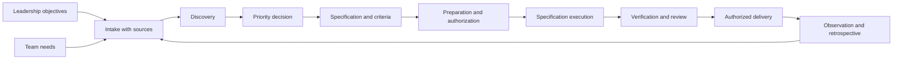

# Workflows — common SDD architecture

**Every adaptation in this directory follows SDD (Spec Driven Development).** SDD is the workflow architecture proposed for this project; design, operations, SRE, FinOps, and Dev adapt its execution. Specifications record intent, scope, and verifiable criteria appropriate to each domain.

This document and [definition.json](definition.json) describe a model. They do not execute phases, authenticate approvals, or block CI on their own. The initial objective is to try the journey and its artifacts with one team and a limited case.

## Common cycle

The skill and template associations below and in the JSON are initial references for software. Each adaptation must define associations appropriate to its domain while preserving the phases and advancement contracts. Skill documentation does not authorize its execution.

| Phase | Initial software reference | Proposed common artifact and advancement condition |
| --- | --- | --- |
| Capture | Intake template | Identified objective, source, and owner |
| Discovery | research, grill-with-docs | Explicit evidence, questions, and conflicts |
| Priority | Assisted synthesis | Authorized decision with scope and dependencies |
| Specification | to-spec; PRD/spec templates | Reviewed specification and criteria; new content starts as draft |
| Preparation | to-tickets | Work units linked to the spec; separate execution authorization |
| Execution | implement, tdd, codebase-design | Artifact or action within authorized scope and conditions |
| Verification/review | code-review; microruntimes in the future | Evidence meeting the criteria defined for the domain |
| Delivery | Future integration | Environment-specific authorization and policy |
| Learning | retro | Results and proposals for adjusting the next cycle |

Associated contracts: [guardrails](../harness/guardrails). SPEC-GIT-HOOKS-SDD authorizes the local build/test push gate and bounded hook-contract tests. Unrelated tests and service probes retain their authorization boundary; see [AGENTS.md](../../AGENTS.md). SDD associations follow the advisory [rule](../harness/rules/0001-sdd.rule.md) and [guardrail](../harness/guardrails/0002-sdd.gr.md).

## Domain adaptations

| Documentary adaptation | Specialization within the same SDD |
| --- | --- |
| [Dev](dev/README.md) | Software planning, implementation, review, audit, and refinement using the installed Pocock skills |
| [Operations](operations/README.md) | Change plans, operational execution, infrastructure checks, and connections to CI/CD, cloud, and inventory |
| [SRE](sre/README.md) | Reliability criteria, operational signals, and connections to observability and incident management |
| [FinOps](finops/README.md) | Economic criteria, cost measurement, and connections to billing and consumption sources |

Design remains a proposed specialization; its earlier adaptation document is absent from the current tree.

Adaptations change **what to verify, when to verify, and which tools to connect**, as well as skills and artifact types. They may add checkpoints within common phases; the verification phase consolidates evidence. They do not redefine the SDD cycle. Identification, versions, ownership, permissions, and traceability remain shared. Domain owners still need to define specific formats and checkpoints.

Rigor profiles are a separate hypothesis; they do not amount to choosing another methodology. Reuse shared capabilities when sufficient. FinOps may provide checks for operations or design without requiring a second complete journey.

## Authority

Authorized people decide commitments, criteria, and risk acceptance. Executable rules, when implemented, will check conditions and permissions. LLMs synthesize, propose, and carry out bounded activities. A persuasive response is not evidence.

## How to experiment now

Start from the phase the user authorized. Reuse the available context and valid decisions; record material gaps instead of inventing prerequisites or requiring a new discovery round. For a new request that needs discovery, use the [intake format](../../.agents/templates/intake.md).

Phase skills preserve explicit upstream invocation. The package does not chain phases automatically. When the user authorizes a phase, load its skill and local configuration. New artifacts remain draft until the applicable decision; do not fabricate approvers or timestamps. Save artifacts using the type, directory, and sequence defined in the [tracker](../artifacts/design/0006-DD-artifact-tracker.dd.md).

## Criteria and return paths

Missing evidence keeps an assessment inconclusive or failed according to the criterion, never approved. A gap found during review returns work to implementation; a scope change returns it to specification. Significant changes require reassessing approvals of earlier versions.

The [candidate profiles](../artifacts/design/0004-DD-workflow-profiles.dd.md) — exploration, delivery, and enhanced rigor — would preserve formats, versioning, and traceability while varying depth by risk. Their selection depends on organizational criteria still to be defined and could not disable fundamental controls. Incidents and exceptional situations still need specific handling within the cycle; urgency does not imply authorization.

The proposal is to try one profile before implementing three. This sequence does not authorize identical adoption for hundreds of developers or implement setup, an SDK, or automatic profile selection.

## Sources

- [Pocock: grill-with-docs chain and limitations](https://github.com/mattpocock/skills/blob/49dd158d1076134a641b33efb035946536778336/docs/engineering/grill-with-docs.md).
- [CNCF: platforms as products and adoption](https://tag-app-delivery.cncf.io/whitepapers/platforms/).
