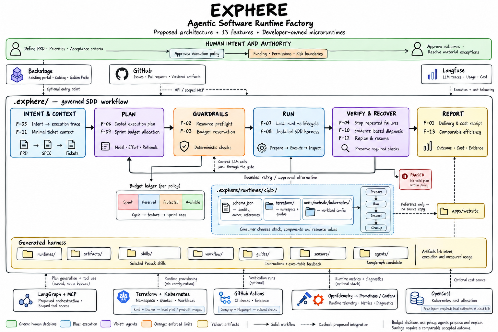

<h1 align="center">Exphere</h1>

[](.agents/features/assets/exphere-readme-banner.png)

**Microruntimes for existing applications. A foundation for cost-aware agentic delivery.**

Exphere explores a developer platform that connects product intent, execution context, and delivery costs. Teams keep ownership of their applications and infrastructure choices; microruntimes provide the proposed execution boundary around them.

Today, this repository contains a documentation website, a Go CLI scaffold, an empty TypeScript SDK API, and the contracts behind thirteen proposed features. Shared team budgets, agent orchestration, and runtime automation remain product direction.

[Quick start](#quick-start) · [Architecture](#architecture) · [13 feature proposals](.agents/features/README.md) · [CLI reference](packages/cli/README.md)

## What you can use today

| Component | Current behavior |
| --- | --- |
| Go CLI | Run help and version commands; unsupported initialization fails explicitly without creating files. |
| Documentation website | Explore the Next.js/Nextra introduction and Getting Started page locally. |
| SDK | Inspect the separate TypeScript package boundary; its API remains empty. |
| Design and web packages | Reuse the workspace's generated design tokens and shared ExphereShader React surface. |
| Project contracts | Read the proposed features, SDD workflow, microruntime specifications, and local FinOps policies. |

The SDK and CLI are private workspace packages. There is no published `exphere` installer demonstrated here. The website's `npx exphere init` command previews the intended interface; it is not a working onboarding command.

## Quick start

Requirements: repository access, Git, Node.js **22.22.1 or newer**, the manifest-pinned **pnpm 12.4.2**, and **Go 1.23+** for the CLI. Retained source-contract checks also use a POSIX shell and `jq`.

```sh
git clone https://github.com/jonatassales/exphere.git
cd exphere
pnpm install --frozen-lockfile

pnpm ex --help
pnpm ex version
```

The CLI prints its supported commands and scaffold version. It does not create a runtime. `init` is reserved and returns an explicit nonzero result without changing consumer files.

To explore the documentation website:

```sh
pnpm dev --filter=website
```

Open the local address printed by Next.js and visit `/docs` for Getting Started. Turborepo builds shared dependencies first. Stop the foreground process when finished.

Installation activates repository-local Husky hooks. It does not install `ex` globally or modify shell profiles. `pnpm install --ignore-scripts` skips lifecycle commands; `HUSKY=0` disables Husky installation/execution.

## Microruntime CLI

A microruntime is the proposed execution configuration around existing application components. A unit named `website` would reference `apps/website`; application source stays in its own directory.

The local pilot design assigns images, resources, replicas, probes, and scheduling to native Kubernetes configuration, with Terraform preparing namespace and quotas. Its descriptor connects those authorities without duplicating editable values. These are retained design contracts, not implemented Go commands.

The earlier shell CLI's runtime generation, validation, setup, Terraform/Kubernetes adapters, and legacy behavior have been retired. Existing schemas and source-contract fixtures preserve earlier work; they do not prove feature parity in the Go scaffold.

Read the [current CLI reference](packages/cli/README.md) and [microruntime pilot requirements](.exphere/artifacts/prd/0002-PRD-local-microruntimes.prd.md) for the distinction between supported commands and planned behavior.

## Architecture

The product direction brings together three responsibilities:

- **FinOps:** connect covered spending to accepted outcomes and the team's authorized budget.
- **Agentic delivery:** coordinate work through intent, context, required checks, and evidence, with fewer routine human interventions.
- **Microruntimes:** provide reusable execution boundaries around consumer-selected components and tools.

The following diagram is a **proposal**. Backstage supplies ownership and component context through a configured, authorized connection. Artifact bodies come from their source. RAG assembles context and prior outcomes; the allocator recommends investments; LangGraph coordinates model and effort choices; deterministic controls reserve funds before covered paid calls.

[](.agents/features/assets/backstage-context-team-budget.png)

**Funding belongs to the team.** Features receive adjustable estimates and allocations. Developers and tickets do not receive independent spending grants. Planning, retrieval, review, retries, and execution must declare their cost coverage. Historical evidence can improve an estimate; it cannot prove future revenue or turn unused budget into savings.

The proposed integration complements an existing developer portal. It does not require replacing Backstage or moving application source into Exphere. Read the [context and funding proposal](.agents/features/README.md#backstage-context-and-team-funded-execution) for ownership, permissions, memory, and accounting boundaries.

### Feature illustrations

The earlier end-to-end factory sketch shows the thirteen capabilities and optional tools. **Its cycle/feature/sprint-cap wording is superseded by the team-budget proposal above.**

[](.agents/features/assets/runtimes-factory.png)

- [Backstage context and shared team budget](.agents/features/assets/backstage-context-team-budget.png): current architecture refinement, including the proposed agents tree.
- [Earlier end-to-end factory sketch, full size](.agents/features/assets/runtimes-factory.png).
- [Image provenance and Backstage attribution](.agents/features/assets/README.md).

Both images are design material, not screenshots of running integrations.

## Feature direction

The [feature register](.agents/features/README.md) contains thirteen proposals with acceptance criteria, dependencies, and limitations. Implementation requires its own approved scope.

| Area | Proposed features |
| --- | --- |
| Explain the delivery | F-01 cost report · F-05 intent-to-execution traceability |
| Bound consumption | F-02 resource preflight · F-03 shared team budget · F-04 repeated-failure detection |
| Plan with evidence | F-06 costed execution planning · F-09 team allocation and sprint reporting · F-11 task context |
| Execute and recover | F-07 local lifecycle · F-08 installed SDD harness · F-10 diagnosis · F-12 bounded resume |
| Evaluate improvement | F-13 comparable-delivery efficiency |

A workflow engine, shared financial ledger, Backstage connector, RAG store, model router, and measured savings remain future work. The proposed agents tree describes application responsibilities; it is not generated by the current CLI.

## Workspace

| Location | Responsibility |
| --- | --- |
| [`packages/cli/`](packages/cli/README.md) | Dependency-free Go `ex` scaffold with a private pnpm task bridge. |
| `packages/sdk/` | Separate private TypeScript `@exphere/sdk`; API remains empty. |
| [`packages/design/`](packages/design/README.md) | Public-intent `@repo/design`; generated CSS/JSON design tokens. |
| [`packages/web/`](packages/web/README.md) | Public-intent `@repo/web`; shared ExphereShader React surface. |
| [`apps/website/`](apps/website/README.md) | Next.js/Nextra project introduction and Getting Started page. |
| [`.agents/features/`](.agents/features/README.md) | Proposed capabilities and feature illustrations. |
| [`.exphere/artifacts/`](.exphere/artifacts/design/0006-DD-artifact-tracker.dd.md) | Typed PRDs, specs, tickets, research, and design records. |
| [`.exphere/workflow/`](.exphere/workflow/README.md) | Documentary SDD lifecycle and [AIHero workflow skills](.exphere/workflow/skills/README.md). |
| `.exphere/harness/` | Shared SDD, FinOps, and Twelve-Factor policies plus FinOps/AWS skills. |
| [`.agents/`](.agents/README.md) | Local engineering guidance, templates, and [Go skills](.agents/skills/README.md). |

Public-intent metadata does not establish package publication. Generated evidence retains the ignored `.audits/evidence/runs/` destination.

For website work, use `pnpm --filter @repo/design dev` separately while editing tokens. `pnpm build` prepares production outputs; `pnpm start --filter=website` serves the built application locally. See the [website guide](apps/website/README.md) for its current presentation and limits.

## Developer checks

Root aliases invoke native pnpm/Turborepo/Go tools. Retired wrapper directories outside the CLI are not part of the current workflow.

| Command | Purpose |
| --- | --- |
| `pnpm build` | Build declared Go and JavaScript/TypeScript workspaces. |
| `pnpm test` | Run declared package tests, retained CLI source-contract checks, and disposable Husky hook contracts. |
| `pnpm typecheck` | Run declared workspace type checks, including Go vet. |
| `pnpm check` / `pnpm lint` | Run the existing Biome checks. |
| `pnpm format` | Apply Biome formatting changes explicitly. |
| `pnpm harness:score` | Run the local harness diagnostic; findings are informational. |

Pre-commit checks eligible staged files and reports the harness diagnostic. Commit-msg validates Conventional Commits and reports advisory ticket/spec associations. Pre-push checks the clean, checked-out outgoing revision and runs build followed by test.

Biome does not cover Go, shell, or Markdown. Source-contract fixtures do not establish a running cluster or provider integration. Hooks can be bypassed; they provide feedback rather than authenticated approval or authorization to publish. `verifyDepsBeforeRun: false` prevents implicit dependency installation before tasks.

Use one `Ticket: <stable-id>` trailer per commit and `Spec: <stable-id>` in each PR body. Follow the [SDD rule](.exphere/harness/rules/0001-sdd.rule.md) and [guardrail](.exphere/harness/guardrails/0002-sdd.gr.md), including separate Standards and Spec reviews of the same snapshot.

## CI and review

GitHub Actions runs native installation, checks, type checking, builds, and tests. It does not run the retired shell agent-review provider or make paid model requests. Separate Standards and Spec review remains the contributor obligation in the [code-review skill](.exphere/workflow/skills/code-review/SKILL.md).

Report the revision and scope actually verified. A local check does not prove hosted CI success, and CI success does not prove production readiness.

## Project documents

| Start here | What it contains |
| --- | --- |
| [Product requirements](.exphere/artifacts/prd/0001-PRD-exphere.prd.md) | Problem, intended outcomes, scope, and unvalidated hypotheses. |
| [Local microruntime pilot](.exphere/artifacts/prd/0002-PRD-local-microruntimes.prd.md) | Earlier configuration and lifecycle contracts for future implementation. |
| [Design overview](.exphere/artifacts/design/0001-DD-exphere.dd.md) | Product and system boundaries. |
| [Feature register](.agents/features/README.md) | Thirteen proposals and the current funding/context decisions. |
| [This documentation specification](.exphere/artifacts/specs/0029-SPEC-backstage-team-budget-proposal.spec.md) | Scope, requirements, and evidence for this presentation. |
| [Go and documentation migration](.exphere/artifacts/specs/0028-SPEC-pr19-completion.spec.md) | Current Go, website, native-tooling, and skills integration. |
| [Artifact tracker](.exphere/artifacts/design/0006-DD-artifact-tracker.dd.md) | Stable IDs, naming, directories, and states. |
| [Local contributor guidance](AGENTS.md) | Scope, ownership, workflow, and repository rules. |

## Current limits

Exphere is experimental. The SDK API is empty, the Go CLI is a scaffold, and these diagrams do not deliver an agent workflow or financial enforcement. Provisioning, production access, deployment, cloud billing integrations, and organizational adoption require their own implementation and evidence.

Keep changes scoped and preserve consumer-owned decisions. The surviving project documents define their own boundaries; removed historical guidance is not silently replaced by this README.
