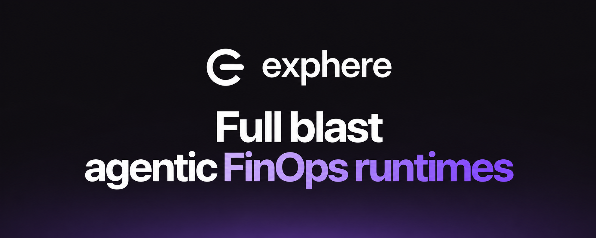
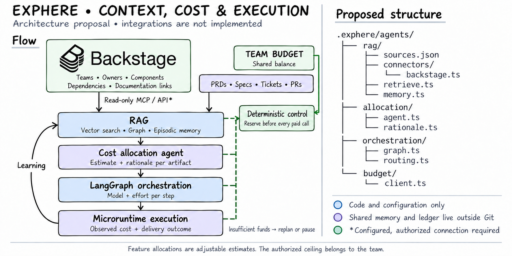

[](.agents/features/assets/exphere-readme-banner.png)

<p align="center">
  <strong>Microruntimes for existing applications. A foundation for cost-aware agentic delivery.</strong>
</p>

<p align="center">
  <a href="#quick-start">Quick start</a> ·
  <a href="#architecture">Architecture</a> ·
  <a href=".agents/features/README.md">13 feature proposals</a> ·
  <a href="packages/cli/README.md">CLI reference</a>
</p>

Bring product intent, delivery context, and cost into the same conversation. Exphere explores a developer platform for teams that want to use agents while keeping control of their applications, tools, and spending.

## Your stack. Your context. Your decisions.

- **Make delivery costs visible.** Connect proposed work to a shared team budget and the outcomes it is meant to support.
- **Give agents useful context.** Bring ownership, requirements, and prior evidence into planning and execution.
- **Build around what you have.** Compose microruntimes around existing applications without handing over your stack choices.

These are the product's direction. Exphere is experimental: today you can explore the documentation, run the Go CLI's help/version commands, and use the workspace's design tokens and shared web surface. Runtime automation and the SDK API are not implemented.

## Architecture

The proposed architecture connects your developer portal and intent artifacts to context retrieval, investment planning, agent orchestration, and microruntime execution. A shared team budget bounds the proposed paid work; results feed future decisions.

[](.agents/features/assets/backstage-context-team-budget.png)

Keep your existing developer portal. Keep application source with its owners. Use Exphere's [13 feature proposals](.agents/features/README.md) to explore what a cost-aware delivery platform could make possible.

[Explore the architecture](https://exphere.vercel.app/docs/architecture) · [Image provenance and attribution](.agents/features/assets/README.md)

## Quick start

Start with the [documentation](https://exphere.vercel.app/docs) for the current capabilities and a local walkthrough. With Node.js 22.22.1+, pnpm 12.4.2 and Go 1.23+ installed, clone this repository and run:

```sh
pnpm install --frozen-lockfile
pnpm ex --help
pnpm dev --filter=website
```

Installation activates repository-local Husky hooks. The CLI is a scaffold; the website's `npx exphere init` is preview text, not a working installer.

## Developer checks

Setup, workspace commands, hook behavior, and contribution guidance live in the [Development guide](apps/website/app/docs/development/page.mdx). The [CLI reference](packages/cli/README.md) and [project guidance](AGENTS.md) describe their own current boundaries.

Exphere does not yet provide a workflow engine, financial enforcement, production integrations, or demonstrated savings. The diagrams describe proposals, not running systems.
